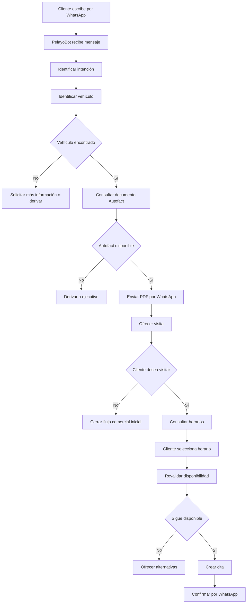

# 00 - Resumen del proyecto

## Nombre

PelayoBot

## Empresa

Automóviles Pelayo

## Tipo de producto

Sistema de automatización comercial y atención inicial por WhatsApp.

## Problema central

Clientes interesados en vehículos consultan por WhatsApp y actualmente dependen de atención manual para:

- recibir antecedentes del vehículo;
- recibir el Autofact;
- conocer disponibilidad;
- coordinar una visita.

PelayoBot automatiza el flujo repetitivo manteniendo a los ejecutivos disponibles para conversaciones de mayor valor.

## Usuario externo principal

Potencial comprador de un vehículo.

No requiere cuenta en la plataforma.

Su identificador inicial será su número de WhatsApp.

## Usuarios internos

- ejecutivo de ventas;
- administrador;
- eventualmente encargado de inventario.

## Propuesta de valor

Reducir el tiempo entre:

```text
"Me interesa este auto"
```

y:

```text
"Tengo el Autofact y una visita confirmada"
```

## Flujo principal



## Hitos funcionales

### Hito 1
WhatsApp recibe y responde mensajes reales.

### Hito 2
Cliente consulta un vehículo existente y el sistema lo identifica.

### Hito 3
El Autofact correcto se envía automáticamente.

### Hito 4
Cliente agenda una visita.

### Hito 5
Existe panel administrativo mínimo.

### Hito 6
IA mejora comprensión sin controlar reglas de negocio.

## Definición de éxito del MVP

Una demostración es exitosa si:

1. se inicia desde un WhatsApp real;
2. el cliente identifica un vehículo;
3. el sistema lo encuentra en la base;
4. se envía el Autofact correcto;
5. se muestran horarios;
6. se reserva uno;
7. la cita queda persistida;
8. el usuario recibe confirmación.
