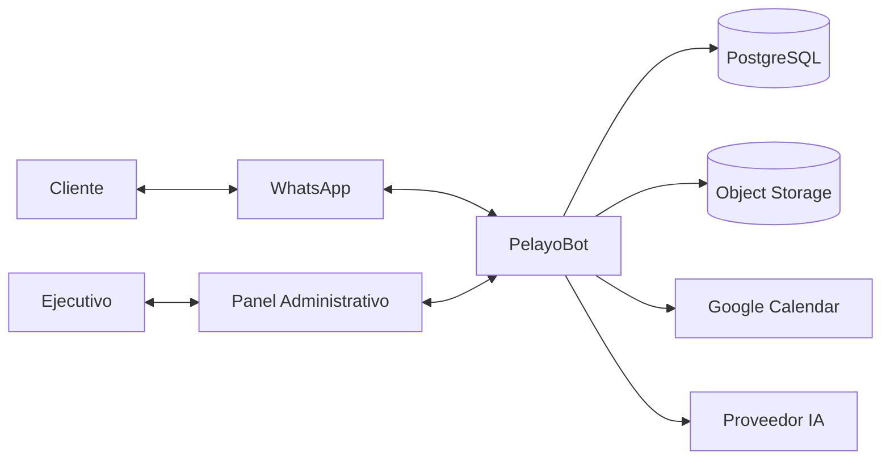
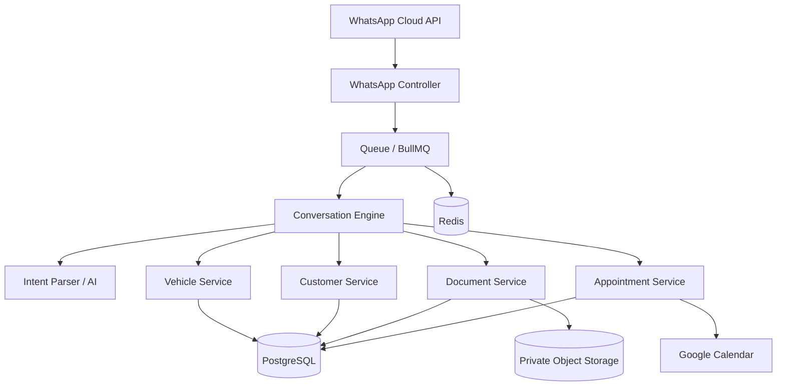
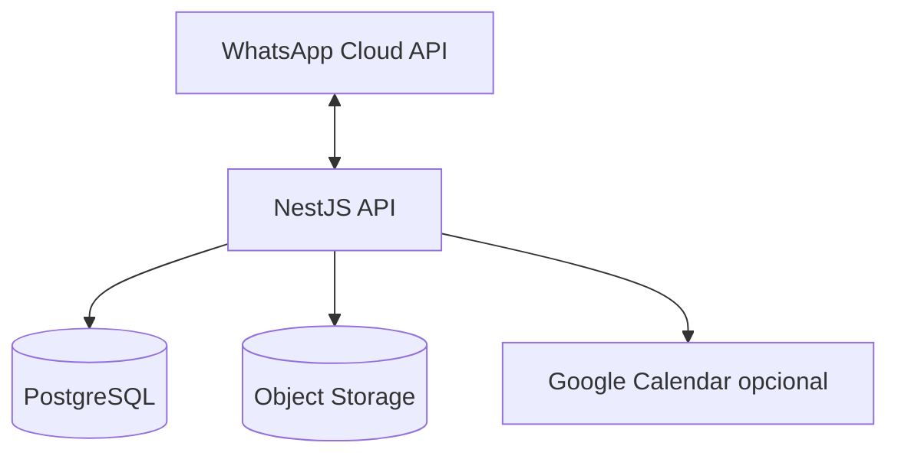
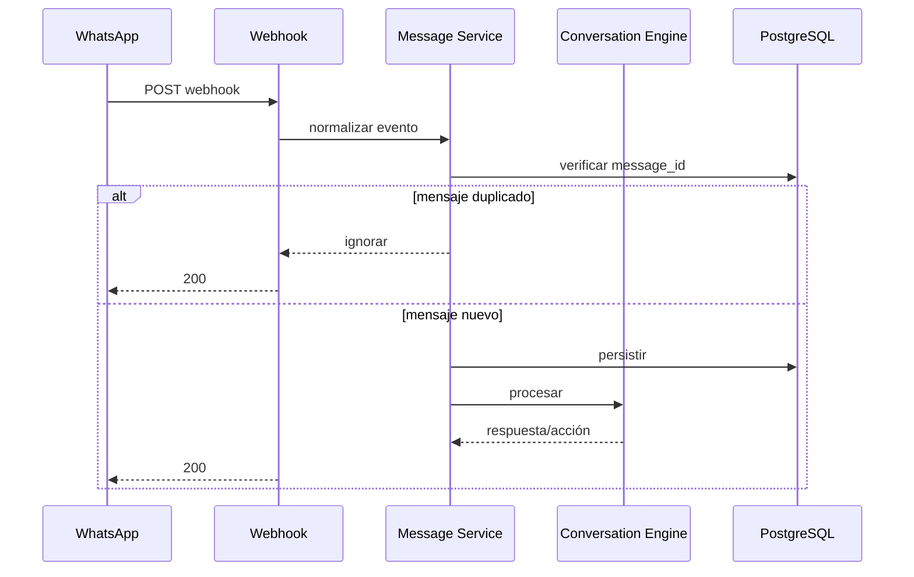
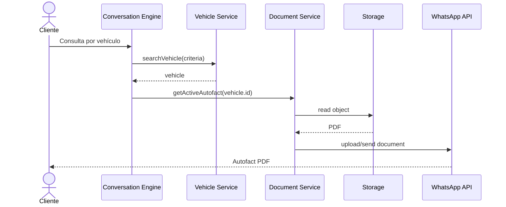
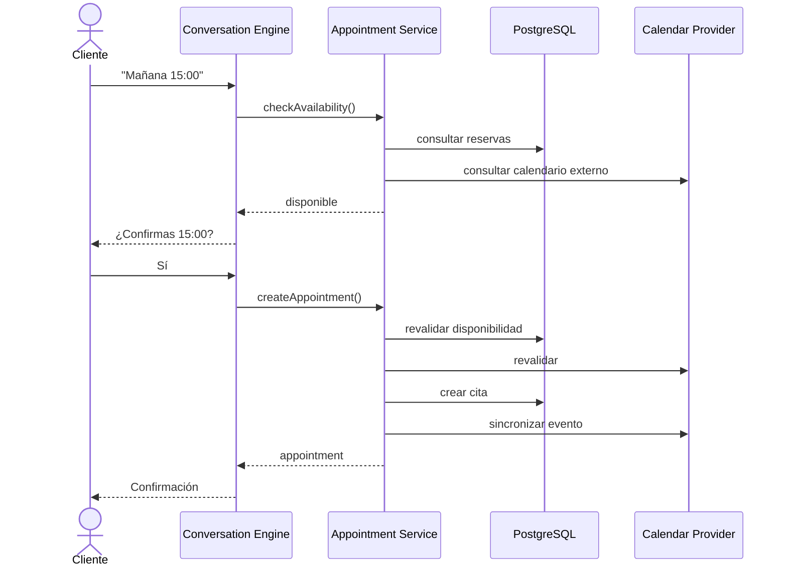

# 03 - Arquitectura

## 1. Estilo arquitectónico

PelayoBot será inicialmente un **monolito modular**.

Motivos:

- equipo pequeño;
- dominio todavía evolucionando;
- despliegue más simple;
- transacciones más sencillas;
- menos sobrecarga operacional;
- separación lógica suficiente.

No utilizar microservicios inicialmente.

---

## 2. Diagrama de contexto



---

## 3. Arquitectura lógica objetivo



---

## 4. Arquitectura MVP

Redis/BullMQ no son obligatorios para el primer commit funcional.



Regla:

> Primero demostrar el flujo; después separar trabajos pesados mediante cola.

---

## 5. Módulos backend

```text
src/
├── app.module.ts
├── main.ts
│
├── modules/
│   ├── whatsapp/
│   │   ├── whatsapp.module.ts
│   │   ├── whatsapp.controller.ts
│   │   ├── whatsapp.service.ts
│   │   └── whatsapp.types.ts
│   │
│   ├── conversations/
│   │   ├── conversations.module.ts
│   │   ├── conversation.service.ts
│   │   ├── conversation-machine.ts
│   │   └── intent-router.ts
│   │
│   ├── customers/
│   ├── vehicles/
│   ├── documents/
│   ├── appointments/
│   ├── ai/
│   ├── auth/
│   └── audit/
│
├── infrastructure/
│   ├── prisma/
│   ├── storage/
│   ├── calendar/
│   └── queue/
│
└── common/
    ├── errors/
    ├── logging/
    ├── validation/
    └── config/
```

---

## 6. Responsabilidades

### WhatsApp Module
Responsable de transporte.

Debe:

- validar webhook;
- parsear eventos;
- extraer `message_id`;
- enviar mensajes;
- enviar documentos;
- enviar botones/listas.

No debe:

- decidir qué vehículo corresponde;
- decidir disponibilidad;
- ejecutar reglas de negocio.

### Conversation Module
Orquestador.

Debe:

- cargar conversación;
- conocer estado;
- interpretar intent;
- ejecutar transición;
- invocar servicios de dominio;
- construir siguiente respuesta.

### Vehicle Module
Fuente de verdad del inventario interno.

### Document Module
Relaciona vehículo con archivos privados y entrega documentos al adaptador de WhatsApp.

### Appointment Module
Maneja:

- disponibilidad;
- reservas;
- revalidación;
- cancelaciones;
- sincronización opcional.

### AI Module
Convierte lenguaje natural en estructura.

Nunca debe ejecutar acciones irreversibles por sí solo.

---

## 7. Flujo inbound



---

## 8. Flujo documento



---

## 9. Flujo reserva



---

## 10. Principio de dependencias

Los módulos de dominio no deben depender directamente de SDKs externos.

Preferir adaptadores:

```text
AppointmentService
        ↓
CalendarProvider interface
        ↓
GoogleCalendarAdapter
```

```text
DocumentService
        ↓
StorageProvider interface
        ↓
S3StorageAdapter
```

Esto permite probar lógica sin infraestructura real.


---

## 12. Semántica del webhook y cola durable en MVP

Objetivo y flujo implementado (Sprint 2):

```text
Webhook recibe
→ valida HMAC-SHA256 y esquema Zod
→ persiste atómicamente en PostgreSQL (RECEIVED)
→ responde HTTP 200 de inmediato (< 150ms)
→ activa worker asíncrono desacoplado
```

### Ciclo de vida y máquina de estados del mensaje:

```text
       ┌───────────┐
       │ RECEIVED  │ (Mensaje persistido de forma durable en PostgreSQL)
       └─────┬─────┘
             │ Reclamo atómico con claim_token UUID
             ▼
       ┌───────────┐
       │  CLAIMED  │ (Worker obtuvo lease de 60s; verifica vigencia en DB)
       └─────┬─────┘
             │ Transición atómica a SENDING + creación de WhatsAppSendAttempt (INITIATED)
             │ Aborta antes de Meta si el lease expiró o fue reclamado (update count === 0)
             ▼
       ┌───────────┐
       │  SENDING  │ (Despacho a Meta con biz_opaque_callback_data = attemptId)
       └─────┬─────┘
             ├──────────────────────┬──────────────────────┬──────────────────────┐
             │ Éxito confirmado     │ Falla transitoria    │ Falla fatal          │ Incertidumbre de red
             │ (HTTP 200 + wamid)   │ Meta (131016/500)    │ (131030/131031 o intentos  │ (timeout, socket drop
             │                      │ y attempts < max     │ agotados)            │ HTTP 200 sin wamid o
             │                      │                      │                      │ lease expirado)
             ▼                      ▼                      ▼                      ▼
       ┌───────────┐          ┌──────────────┐       ┌──────────────┐       ┌───────────┐
       │ PROCESSED │          │RETRY_PENDING │       │ FAILED_FINAL │       │ UNCERTAIN │
       └───────────┘          └──────┬───────┘       └──────────────┘       └─────┬─────┘
                                     │ (nextRetryAt)         ▲                    │
                                     ▼ (lte now)             │ (si falla          ▼
                               (Reclamo atómico           definitiva)      (Reconciliación
                                y reintento)                                vía statuses
                                                                            con exact wamid
                                                                            o opaque data)
```

### Reglas críticas de resiliencia:

1. **Persistencia atómica**: La deduplicación se realiza sobre `external_message_id`. Si PostgreSQL falla al persistir, el webhook responde HTTP 500 para forzar el reintento de Meta.
2. **Reclamo atómico con token y elegibilidad estricta**: Cada worker genera un `claim_token` UUID único. Solo califica para reclamo un registro en estado `RECEIVED` o `RETRY_PENDING` con `nextRetryAt <= now`. Un registro en `FAILED_FINAL` queda permanentemente excluido de la cola.
3. **Transición atómica verificada antes del despacho externo**: La transición `CLAIMED -> SENDING` y el registro de `WhatsAppSendAttempt` se ejecutan en una transacción corta que verifica `count === 1` y `processingStartedAt >= leaseExpiration`. Si el lease fue perdido o venció, el worker aborta inmediatamente sin contactar a Meta.
4. **Cero reenvíos ciegos ante incertidumbre**: Errores de red (`ECONNRESET`, timeouts de socket, respuestas HTTP 200 sin ID de mensaje o leases expirados en fase `SENDING`) marcan el mensaje como `UNCERTAIN` con `delivery_uncertain = true`. Jamás se reenvía a ciegas al cliente.
5. **Correlación exacta sin adivinanzas**: En cada despacho se envía el `attemptId` en el parámetro `biz_opaque_callback_data` de Meta Cloud API. Los webhooks de estado (`statuses`) correlacionan exclusivamente por este token unívoco o por el `outbound_message_id` exacto. Jamás se utiliza el número de teléfono como fallback para evitar asignar confirmaciones al mensaje equivocado.
6. **Reconciliación idempotente y barrido**: La persistencia de eventos de estado tolera colisiones `P2002` reanudando la reconciliación si no estaba completada. La cola ejecuta periódicamente `reconcilePendingEvents()` para procesar eventos que arribaron fuera de orden.
7. **Desacople total**: El webhook nunca espera respuestas de Meta, llamadas de IA ni accesos lentos. El tiempo de respuesta es sub-50ms.
8. **Evolución futura**: Redis / BullMQ se introducirá únicamente cuando el volumen distribuido multi-nodo o la necesidad de colas de prioridad avanzada lo exijan (ADR-008).

---

## 13. Frontera provisional de agenda

La arquitectura define `AppointmentService` y `CalendarProvider`, pero la política de disponibilidad todavía NO está cerrada.

Por tanto:

```text
AppointmentService
        ↓
AvailabilityPolicy
        ↓
implementación provisional / fake
```

Hasta validar las reglas de negocio, no asumir que el recurso reservado es únicamente:

- el vehículo;
- un vendedor;
- una sucursal;
- un box;
- un calendario.

La abstracción debe permitir incorporar uno o varios recursos posteriormente sin reescribir el motor conversacional.
