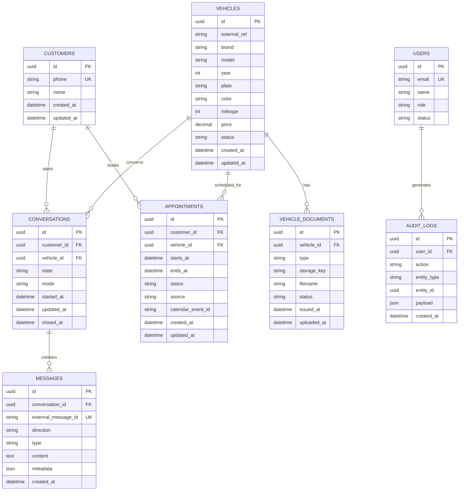

# 04 - Modelo de datos

## ERD inicial



## Estados de VEHICLES

```text
AVAILABLE
RESERVED
SOLD
INACTIVE
```

Solo `AVAILABLE` debe ofrecerse por defecto.

## Tipos de documento

```text
AUTOFACT
REVISION_TECNICA
PADRON
PERMISO_CIRCULACION
MAINTENANCE
OTHER
```

MVP utiliza `AUTOFACT`.

## Estado de documento

```text
ACTIVE
REPLACED
ARCHIVED
```

## Estados de APPOINTMENTS

```text
PENDING
CONFIRMED
CANCELLED
COMPLETED
NO_SHOW
```

## Modos de conversación

```text
BOT
HUMAN
```

## Dirección de mensajes

```text
INBOUND
OUTBOUND
```

## Tipos de mensajes

```text
TEXT
DOCUMENT
INTERACTIVE
IMAGE
SYSTEM
```

## Constraints recomendadas

- `customers.phone` UNIQUE
- `messages.external_message_id` UNIQUE
- `vehicles.plate` UNIQUE cuando exista y sea confiable
- FK obligatorias para documentos
- índices en:
  - vehicles(status)
  - vehicles(brand, model, year)
  - appointments(starts_at, status)
  - conversations(customer_id, state)


---

## Modelo de agenda: estado provisional

La entidad `APPOINTMENTS` actual representa el mínimo necesario para construir el flujo, pero NO modela todavía la capacidad real del negocio.

No asumir que `vehicle_id` por sí solo representa el recurso cuya disponibilidad debe bloquearse.

Una posible evolución futura, NO aprobada todavía, podría incorporar:

```text
RESOURCES
- id
- type
- name
- capacity

APPOINTMENT_RESOURCES
- appointment_id
- resource_id
```

o relaciones explícitas con vendedores/sucursales.

La elección dependerá de las respuestas de negocio de `13-preguntas-abiertas.md`.

Hasta entonces:
- mantener `Appointment` simple;
- encapsular disponibilidad en servicio/policy;
- evitar constraints de capacidad irreversibles.
