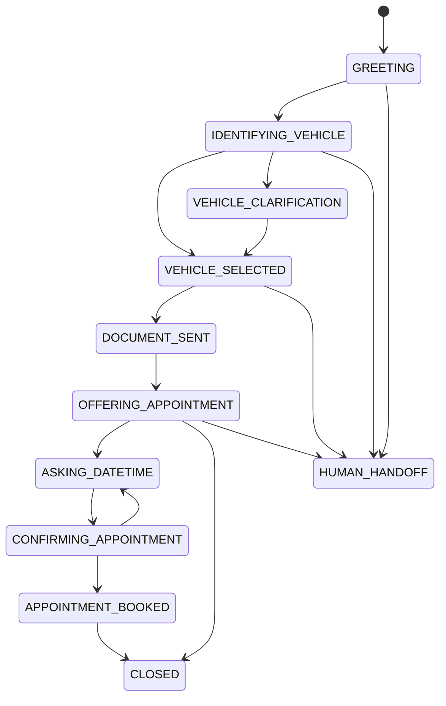

# 05 - Flujos conversacionales

## 1. Principio

La conversación se modelará como una máquina de estados.

No depender de un prompt gigante para controlar la lógica.

## 2. Estados iniciales

```text
GREETING
IDENTIFYING_VEHICLE
VEHICLE_CLARIFICATION
VEHICLE_SELECTED
DOCUMENT_SENT
OFFERING_APPOINTMENT
ASKING_DATETIME
CONFIRMING_APPOINTMENT
APPOINTMENT_BOOKED
HUMAN_HANDOFF
CLOSED
```

## 3. State diagram



## 4. Ejemplo feliz

Cliente:

> Hola, estoy viendo un Mazda 3 2021.

Sistema:

> ¡Hola! 👋 Encontré el Mazda 3 2021 disponible. Te enviaré el informe Autofact asociado para que puedas revisar sus antecedentes.

Sistema envía PDF.

Sistema:

> ¿Te gustaría agendar una visita para verlo?

Botones:

- Agendar visita
- Hablar con ejecutivo

Cliente:

> Agendar visita

Sistema:

> Tengo disponibles estos horarios:
>
> - 11:00
> - 15:00
> - 17:00

Cliente:

> 15:00

Sistema:

> ¿Confirmas tu visita para el martes a las 15:00?

Cliente:

> Sí

Sistema:

> ✅ Tu visita quedó confirmada.

## 5. Desambiguación

Cliente:

> Quiero ver el Mazda blanco.

Backend encuentra dos.

Sistema:

> Encontré dos vehículos que coinciden:
>
> 1. Mazda 3 2021
> 2. Mazda CX-5 2022
>
> ¿Cuál te interesa?

La IA no elige por el usuario.

## 6. Documento faltante

Sistema encuentra vehículo, pero no Autofact.

Respuesta:

> Encontré el vehículo, pero el informe no está disponible automáticamente en este momento. Puedo derivarte con un ejecutivo para continuar.

Transición:

```text
VEHICLE_SELECTED → HUMAN_HANDOFF
```

## 7. Horario ocupado

Cliente:

> Mañana 15:00

Sistema comprueba y está ocupado.

Respuesta:

> Ese horario ya está ocupado. Tengo disponibles:
>
> - 14:00
> - 16:00
> - 17:30

## 8. Condición de carrera

Si estaba libre al ofrecerlo pero deja de estarlo al confirmar:

> Ese horario acaba de ocuparse. Te dejo las alternativas más cercanas disponibles.

Nunca sobreescribir otra reserva.

## 9. Human handoff

Se activa si:

- usuario lo solicita;
- documento no existe;
- vehículo no se logra identificar;
- se supera un número configurable de fallbacks;
- ocurre un error operacional que requiere humano.

Al cambiar a HUMAN:

```text
conversation.mode = HUMAN
```

El motor automático deja de responder.

## 10. Comandos globales futuros

- "hablar con ejecutivo"
- "cancelar cita"
- "mi cita"
- "volver"
- "inicio"

Estos comandos deben funcionar incluso dentro de un flujo activo.
