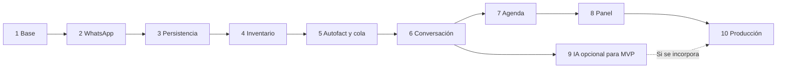

# 10 - Sprints y subtareas de implementación

## 1. Diagnóstico y alcance

Revisión: 21 de septiembre de 2026. El workspace contiene la documentación del producto y el desarrollo del Sprint 1 en `pelayo/` (NestJS 10, TypeScript 5, Prisma 6 con migración inicial generada en SQL, Dockerfile, docker-compose para PostgreSQL 16, validación Zod estricta, logger con redacción profunda de secretos y ESLint 9 configurado). Las pruebas unitarias con Jest pasan (29 pruebas en 5 suites). La verificación en vivo de S1.09 se completó exitosamente contra PostgreSQL 16 real en el puerto 5433, acreditando la ejecución de migraciones, la creación física de tablas, el registro en `_prisma_migrations`, el endpoint `/health` (HTTP 200 y conmutación a 503 ante caída) y el arranque limpio de la aplicación. El Sprint 1 está COMPLETADO. Los Sprints 2 al 10 continúan pendientes de implementación.

La base acordada es un monolito modular NestJS/TypeScript, PostgreSQL/Prisma, WhatsApp Cloud API y almacenamiento privado compatible con S3. La IA interpreta; los servicios de dominio resuelven los hechos. El primer resultado comercial es entregar el Autofact correcto; el segundo es confirmar una visita persistida sin conflictos.

Este plan desarrolla los diez sprints existentes y respeta [PROJECT_CONTEXT](PROJECT_CONTEXT.md), los [ADR](11-decisiones-arquitectonicas.md) y los [requisitos](01-requisitos.md). No resuelve las decisiones de negocio pendientes.

### Ajustes respecto del esquema inicial

- La deduplicación mínima se adelanta al Sprint 2: recibir mensajes reales exige tolerar duplicados desde el inicio. El Sprint 3 completa el historial y su recuperación.
- La cola mínima se implementa antes del envío de PDF en el Sprint 5, o antes si el Sprint 2 necesita reintentos de red. El Sprint 10 la endurece. Esto aplica el disparador de ADR-008 y la sección 12 de arquitectura: no esperar operaciones pesadas dentro del webhook.
- El Sprint 5 incluye una coordinación determinista mínima para demostrar el envío; el Sprint 6 completa la máquina conversacional.
- Agenda, autenticación e IA separan preparación de implementación definitiva. Un demo con mocks no cierra una integración real.
- Seguridad, auditoría y pruebas empiezan con cada funcionalidad; el Sprint 10 consolida su operación.

### Cadencia y seguimiento

Los diez sprints son etapas de alcance, con una semana por sprint como hipótesis original, no una fecha comprometida. La capacidad del equipo, accesos a Meta y decisiones pendientes deben validarse antes de calendarizar. Si una etapa excede la capacidad, dividirla conservando sus IDs y criterios de cierre.

Cada casilla representa una subtarea verificable. Marcarla únicamente con evidencia: código, prueba, documento o demo. Para cada subtarea registrar responsable, estado, estimación y enlace a evidencia en el tablero que use el equipo. Estados sugeridos: pendiente, en curso, bloqueada, en revisión y terminada. No se asignan personas ni fechas sin conocer su disponibilidad.

## 2. Vista general

| Sprint | Resultado visible | Dependencias | Condición especial |
|---|---|---|---|
| 1 | Backend y PostgreSQL ejecutándose | Ninguna | Configuración local reproducible |
| 2 | Mensaje real entra y sale | S1 | Accesos Meta y endpoint de prueba |
| 3 | Historial persistido y recuperable | S2 | Duplicados y reinicios controlados |
| 4 | Inventario consultable sin datos inventados | S3 | PostgreSQL interno; ADR-010 sigue pendiente |
| 5 | Consulta precisa → Autofact correcto | S4 | Storage privado y cola antes de PDF |
| 6 | Conversación guiada y derivación humana | S5 | Definir operación humana para uso real |
| 7 | Visita confirmada y persistida | S6 | ADR-009 para política definitiva |
| 8 | Panel de gestión protegido | S4–S7 para integración completa | ADR-011 para autenticación |
| 9 | Interpretación de lenguaje natural validada | S6; S7 para agenda | ADR-012 antes del parser definitivo |
| 10 | Versión verificable y operable en producción | S1–S8; S9 si se incluye IA | Infraestructura y operación acordadas |

La IA no bloquea el MVP determinista. La interfaz del panel puede prepararse con mocks mientras se resuelve la agenda; su cierre requiere integrar las funciones incluidas.

## 3. Sprint 1 - Base técnica

**Objetivo:** levantar un entorno local reproducible. **Entrada:** documentación revisada. **Áreas previstas:** `pelayo/`, configuración, infraestructura Prisma y módulos base.

### Preparación y estructura

- [x] S1.01 Inicializar NestJS y TypeScript en `pelayo/`, fijar dependencias y documentar versión de runtime (Node.js v20.18.0 LTS, npm 10.8.2).
- [x] S1.02 Crear estructura por dominios y separar controlador, servicio y repositorio/proveedor (`src/modules/*`, `src/infrastructure/*`, `src/common/*`).
- [x] S1.03 Configurar formato, lint, compilación y ejecución de pruebas mediante scripts (`npm run build`, `npm run test`, `npm run lint`).

### Configuración y persistencia base

- [x] S1.04 Crear `.env.example` sin secretos y validación de variables obligatorias al iniciar con Zod.
- [x] S1.05 Preparar Dockerfile y Compose con backend y PostgreSQL 16, volumen y comprobación de salud.
- [x] S1.06 Configurar Prisma y generar archivo de migración inicial (`prisma/migrations/20260921000000_init_system_check`); reservar modelos funcionales para sus sprints.
- [x] S1.07 Implementar health endpoint (`GET /health`) y tratamiento de errores de conexión sin exponer credenciales.
- [x] S1.08 Incorporar logging estructurado y redacción de secretos desde el inicio (en objetos, URLs de mensajes y stack traces).

### Validación y entrega

- [x] S1.09 Verificar arranque desde entorno limpio y aplicación de migraciones reales contra PostgreSQL:
  - **PostgreSQL 16 Nativo (Acreditado):** Verificado con motor PostgreSQL 16.15 en puerto 5433; migración inicial aplicada determinísticamente, tablas `system_checks` y `_prisma_migrations` auditadas con psql, backend iniciado en puerto 3001 con `/health` nominal (HTTP 200), conmutación de fallos ante caída del motor (HTTP 503) y recuperación automática (HTTP 200). Evidencia reproducible persistida con aserciones estrictas en `pelayo/s1-verification.log`.
  - **Docker / Docker Compose (Identificado por separado):** Los artefactos (`Dockerfile`, `docker-compose.yml`, `docker-compose.test.yml`) están completamente implementados y versionados. Su verificación en runtime en este host queda identificada por separado como pendiente de activación de virtualización por hardware (Intel VT-x en BIOS del host Dell) o ejecución en CI/CD Linux.
- [x] S1.10 Documentar comandos de instalación (`npm ci`), arranque, migración y pruebas en el README de la aplicación (`pelayo/README.md`).

**Cierre y demo:** COMPLETADO CON VERIFICACION NATIVA REAL (DOCKER IDENTIFICADO POR SEPARADO). Subtareas S1.01 a S1.10 completadas: 29 pruebas unitarias en 5 suites aprobadas, ESLint 9 sin errores ni advertencias, compilación NestJS limpia a `dist/`, migración determinista en PostgreSQL 16 real, validación física de tablas y registros con psql, y endpoint `GET /health` respondiendo HTTP 200 con conmutación demostrada a HTTP 503 y recuperación a HTTP 200. Dockerfile y Compose preparados para validación en host con virtualización activa. Evidencia completa registrada en `pelayo/s1-verification.log`.

## 4. Sprint 2 - WhatsApp mínimo seguro

**Objetivo:** recibir y responder texto real. **Entrada:** S1 y credenciales de prueba de Meta disponibles. **Áreas:** módulo WhatsApp, proveedor y persistencia mínima de recepción.

### Transporte

- [x] S2.01 Documentar configuración de prueba de Meta y callback HTTPS, sin registrar tokens en archivos versionados (`pelayo/README.md` y `pelayo/.env.example`).
- [x] S2.02 Implementar GET de verificación con validación del token y del challenge (`GET /api/v1/webhooks/whatsapp`).
- [x] S2.03 Implementar POST con comprobación de firma sobre el cuerpo original (`rawBody`) y validación de payload (`WhatsAppSignatureGuard` con HMAC-SHA256 y `timingSafeEqual`).
- [x] S2.03-A Validar payloads: Validar estructura y campos en ejecución mediante Zod (`WhatsAppWebhookSchema`), además de comprobar la firma. Separar payload malformado (HTTP 400 Bad Request) de caída de DB (HTTP 500 sin reconocer recepción para forzar reintento de Meta).
- [x] S2.04 Normalizar ID, remitente, fecha, tipo, texto, respuesta interactiva y referral cuando existan (`NormalizedInboundMessage` en `whatsapp.types.ts`).
- [x] S2.04-A Completar normalización: Extraer respuestas interactivas (`button_reply`, `list_reply`) asignando contenido y estructura tipificada, además de metadata de `referral` (anuncios y campañas). Pruebas comprueban que esos datos llegan a la estructura normalizada.
- [x] S2.05 Distinguir mensajes de eventos de estado; manejar imágenes, documentos y tipos no soportados sin romper el webhook (`statuses` como `IGNORED`, multimedia registrado con aviso amistoso).

### Aceptación y respuesta

- [x] S2.06 Persistir la recepción mínima con ID externo único antes de ejecutar efectos; probar duplicados concurrentes (`inbound_messages` con `external_message_id` único en PostgreSQL).
- [x] S2.06-A Evitar envíos concurrentes: Reclamar cada trabajo de forma atómica antes de enviarlo (`WhatsAppQueueProcessor.claimRecord` mediante actualización condicional en DB). Dos ejecuciones simultáneas del mismo registro producen exactamente una sola llamada al adaptador.
- [x] S2.07 Crear adaptador de envío de texto con timeout y errores explícitos; mantener reglas de negocio fuera del controlador (`WhatsAppSenderAdapter` con `AbortSignal.timeout(2500)`).
- [x] S2.08 Medir el tiempo del webhook en el demo ligero. Desacople asíncrono no bloqueante implementado (`validate -> dedupe -> persist -> 200 -> durable queue trigger`), respondiendo HTTP 200 en < 15ms sin esperar llamadas externas de red.
- [x] S2.08-A Asegurar procesamiento durable: Sustituir `setImmediate` como mecanismo principal por procesamiento recuperable con cola transaccional en PostgreSQL (`WhatsAppQueueProcessor`). Un reinicio después del HTTP 200 no pierde el trabajo aceptado.
- [x] S2.09 Definir respuesta ante fallo de persistencia y recuperación de mensajes aceptados: fail-fast con HTTP 500 si PostgreSQL no puede persistir el mensaje para que Meta reintente.
- [x] S2.09-A Completar recuperación: Procesar pendientes continuamente y por lotes (capaz de recuperar > 50 pendientes y mensajes recientes) con reintentos limitados (3 intentos máximos) y espera progresiva (backoff exponencial 5s, 15s, 45s).
- [x] S2.09-B Tratar envíos inciertos y reconciliación: Máquina de estados robusta con estados `RECEIVED -> CLAIMED -> SENDING -> PROCESSED / RETRY_PENDING / FAILED_FINAL / UNCERTAIN`. Persistencia atómica de `WhatsAppSendAttempt` previa al despacho con `biz_opaque_callback_data = attemptId` hacia Meta Cloud API. Política centralizada de transiciones condicionales (`WhatsAppStateTransitionPolicy`) con verificación transaccional estricta. Hardening acreditado con pruebas: (1) Reenvío real de mensajes en `RETRY_PENDING` creando un nuevo intento correlacionado y despachando al adaptador sin bloqueo por el `outboundMessageId` anterior; (2) Inmutabilidad estricta ante eventos fuera de orden (`read -> delivered -> sent -> failed`) preservando `READ`; (3) Invariante de correlación exacta `attempts: currentAttempt.attemptNumber` que impide que eventos de intentos anteriores sobrescriban el intento vigente; (4) Manejo de `count === 0` con auditoría explícita en `lastError` distinguiendo avance concurrente, duplicado o inconsistencia; (5) Descarte de fallos atrasados si ya existe confirmación de entrega registrada; (6) Protección contra marcados erróneos de abandono en barridos concurrentes (`reconciled: false`); (7) Validación estricta de `maxAttempts` (1 a 10) sin conversión silenciosa a valores por defecto.
- [x] S2.10-A Probar resiliencia real: Suite de integración ejecutada contra PostgreSQL 16 nativo (puerto 5433, `whatsapp-concurrency.integration.spec.ts`) y script de auditoría (`verify-s2-native.js`): (1) Dos workers concurrentes sobre el mismo registro producen exactamente una sola llamada al adaptador y un solo intento en DB; (2) Resolución concurrente de `delivered` y `failed` respetando monotonicidad; (3) Ciclo completo de reintento verificado: intento 1 (`ACCEPTED`) -> webhook fallo transitorio (131016) -> `RETRY_PENDING` -> backoff vencido -> intento 2 (`ACCEPTED`) -> `PROCESSED`; (4) Recuperación de worker interrumpido en `CLAIMED` con lease expirado restaurando a `RECEIVED` con `claimRecoveryCount: 1` sin consumir intentos de envío (`attempts: 0`); (5) Evento atrasado del intento A no modifica al intento B en `SENDING`; (6) Cola de 25 registros agotados no bloquea el procesamiento del siguiente mensaje válido; (7) Cola de 50 eventos huérfanos sin correspondencia no bloquea eventos reconciliables posteriores; (8) Recuperación por lotes de 75 registros con salida defensiva y progreso medido por transiciones efectivas.
- [ ] S2.11-A Demo real completa (Pendiente: requiere credenciales activas de Meta Cloud API): Configurar Meta y callback HTTPS; enviar desde un teléfono al bot y recibir su respuesta. Evidencia del recorrido completo teléfono → webhook → DB → adaptador → teléfono. (Herramienta implementada y verificada en `demo-live-whatsapp.js`; bloqueada por ausencia de credenciales reales en `.env`).

**Cierre y demo:** EN CURSO (S2.09-B y S2.10-A COMPLETADAS Y AUDITADAS CON POSTGRESQL 16 REAL; S2.11-A ABIERTA PENDIENTE DE CREDENCIALES ACTIVAS DE META).
1. Reclamo atómico con `claim_token` UUID verificado (`S2.06-A`): garantiza despacho único ante múltiples workers concurrentes sobre PostgreSQL 16.
2. Transición atómica `CLAIMED -> SENDING` verificada con `count === 1` y registro de intento previo: si el lease expiró o fue perdido, el worker aborta antes de invocar a Meta.
3. Política condicional anti-sobrescritura y separación de estados de transporte y entrega (`S2.09-B`).
4. Reenvío real ante fallos transitorios programados con nuevo intento correlacionado y despacho efectivo al adaptador (`S2.09-B`).
5. Inmutabilidad de entrega ante eventos positivos y negativos fuera de orden (`S2.09-B`).
6. Aislamiento transaccional estricto entre mensaje e intento vigente con comprobación `attempts: attemptNumber` (`S2.09-B`).
7. Desbloqueo y resolución de registros agotados con prevención de bucles infinitos (`S2.09-B`).
8. Pruebas de resiliencia y concurrencia ejecutadas y aprobadas en PostgreSQL 16 real (`S2.10-A`).
9. Procedimiento de revisión y reactivación de eventos abandonados documentado en `pelayo/README.md`.
10. Pendiente de credenciales activas de Meta Cloud API para completar la demo en vivo de extremo a extremo (`S2.11-A`).

## 5. Sprint 3 - Persistencia conversacional

**Objetivo:** conservar clientes, conversaciones y mensajes entre reinicios. **Entrada:** S2. **Áreas:** customers, conversations, messages, Prisma.

### Modelo y repositorios

- [ ] S3.01 Crear migraciones para Customer, Conversation y Message con relaciones e índices del modelo documental.
- [ ] S3.02 Garantizar unicidad de teléfono y `messages.external_message_id`; integrar la recepción mínima de S2 sin perder deduplicación.
- [ ] S3.03 Normalizar la identidad de contacto y crear o recuperar cliente de forma segura ante concurrencia.
- [ ] S3.04 Recuperar conversación activa o crearla; persistir estado y modo BOT/HUMAN.
- [ ] S3.05 Guardar mensajes entrantes y salientes con dirección, tipo, metadata mínima y referencia al proveedor.

### Consistencia y trazabilidad

- [ ] S3.06 Hacer atómicas las escrituras relacionadas y distinguir recepción, procesamiento pendiente, éxito y error.
- [ ] S3.07 Recuperar procesamiento interrumpido sin tratar todo ID existente como trabajo terminado.
- [ ] S3.08 Asociar logs y eventos a mensaje y conversación, evitando datos personales innecesarios.

### Validación y entrega

- [ ] S3.09 Probar con PostgreSQL real clientes repetidos, duplicados simultáneos y rollback ante error.
- [ ] S3.10 Reiniciar la aplicación y demostrar recuperación de historial y trabajo pendiente; cubrir E2E-07.

**Cierre y demo:** dos mensajes del mismo contacto mantienen su historial; un reintento no duplica cliente, mensaje ni respuesta.

## 6. Sprint 4 - Inventario

**Objetivo:** buscar vehículos existentes y pedir aclaración cuando corresponda. **Entrada:** S3. **Áreas:** vehicles, DTOs, repositorio y fixtures.

### Datos y operaciones

- [ ] S4.01 Crear Vehicle con estados e índices; aplicar unicidad de patente solo según dato confiable y modelo acordado.
- [ ] S4.02 Preparar seeds sintéticos: disponible, vendido, reservado, inactivo y dos vehículos similares.
- [ ] S4.03 Implementar alta, consulta, listado y actualización con validación de campos y estados.
- [ ] S4.04 Mantener las operaciones administrativas en entorno local/controlado hasta la autenticación de S8.

### Búsqueda y selección

- [ ] S4.05 Buscar por ID, marca, modelo, año, color, patente y referencia interna registrada.
- [ ] S4.06 Ofrecer únicamente AVAILABLE por defecto y obtener precio y demás atributos desde PostgreSQL.
- [ ] S4.07 Distinguir cero, una o varias coincidencias; devolver candidatos para selección explícita.
- [ ] S4.08 Revalidar el vehículo al seleccionarlo y persistir su asociación con la conversación.
- [ ] S4.09 Documentar carga manual del inventario MVP; dejar integración externa y mapeo publicitario avanzado pendientes de información real.

### Validación y entrega

- [ ] S4.10 Probar búsquedas exactas, sin resultados, ambiguas y vehículos no disponibles; cubrir E2E-03.

**Cierre y demo:** una consulta identifica un vehículo de la base; una consulta ambigua solicita selección sin inventar coincidencias. Los seeds demuestran lógica, no acreditan inventario real de Pelayo.

## 7. Sprint 5 - Autofact y procesamiento asíncrono

**Objetivo:** entregar el PDF activo del vehículo seleccionado. **Entrada:** S4, storage de prueba y archivos de prueba asociados. **Áreas:** documents, storage, queue y adaptador WhatsApp.

### Documentos privados

- [ ] S5.01 Crear VehicleDocument con FK obligatoria, metadata y estados ACTIVE, REPLACED y ARCHIVED.
- [ ] S5.02 Implementar StorageProvider y adaptador S3 compatible con bucket privado y claves independientes de rutas del equipo.
- [ ] S5.03 Crear carga manual/local validando PDF, tamaño permitido y vehículo; documentar reemplazo y tratamiento de múltiples Autofact activos sin seleccionar arbitrariamente.

### Cola antes de operaciones pesadas

- [ ] S5.04 Incorporar Redis/BullMQ para aceptar, persistir, encolar y responder 200 antes del procesamiento de PDF.
- [ ] S5.05 Recuperar eventos persistidos que no llegaron a encolarse por una caída; definir comportamiento cuando Redis no está disponible.
- [ ] S5.06 Implementar worker con reintentos acotados, seguimiento de fallos y control de efectos duplicados por mensaje/operación.

### Selección y envío

- [ ] S5.07 Implementar `getActiveAutofact(vehicleId)` filtrando por tipo AUTOFACT y estado ACTIVE.
- [ ] S5.08 Leer el archivo privado y enviarlo mediante el adaptador de WhatsApp; registrar documento, vehículo y resultado del proveedor.
- [ ] S5.09 Distinguir solicitud aceptada de entrega confirmada; no anunciar envío exitoso ante error o resultado incierto.
- [ ] S5.10 Conectar selección determinista de vehículo → documento → envío, sin esperar la máquina completa de S6.
- [ ] S5.11 Ante archivo ausente, asociación ambigua o storage caído, informar y registrar handoff; no sustituir el PDF.

### Validación y entrega

- [ ] S5.12 Probar documento archivado, PDF incorrecto, ausencia de archivo, fallo de storage y timeout de WhatsApp, incluyendo resultado de envío incierto sin reintento ciego.
- [ ] S5.13 Probar reinicio de worker y fallo entre persistencia y encolado; verificar recuperación y ausencia de efectos repetidos en casos controlados.
- [ ] S5.14 Demostrar desde WhatsApp real el PDF correcto y que el webhook responde antes del envío pesado.

**Cierre y demo:** primer hito comercial, consulta precisa → Autofact. El archivo permanece privado y cada intento es trazable. No se promete entrega exactamente una vez si el proveedor deja un resultado incierto; ese caso requiere reconciliación documentada.

## 8. Sprint 6 - Motor conversacional y handoff

**Objetivo:** conducir el flujo con estados persistentes. **Entrada:** S5. **Áreas:** Conversation Engine, transiciones y comandos.

### Máquina de estados

- [ ] S6.01 Implementar los estados de PROJECT_CONTEXT y una tabla explícita de eventos y transiciones permitidas.
- [ ] S6.02 Completar saludo, identificación, aclaración, selección, envío, oferta de visita y cierre.
- [ ] S6.03 Preparar selección/confirmación de horario con proveedor fake; conectar la agenda real en S7.
- [ ] S6.04 Persistir contexto y transición solo cuando se complete la acción correspondiente; serializar procesamiento por conversación para evitar carreras.
- [ ] S6.05 Definir tratamiento de respuesta inesperada, selección vencida y cambio de vehículo sin reutilizar documentos u horarios anteriores.

### Atención humana

- [ ] S6.06 Implementar solicitud de ejecutivo y handoff por documento faltante, error o límite configurable de fallbacks.
- [ ] S6.07 Persistir modo HUMAN y detener respuestas automáticas, incluidos trabajos pendientes que vuelvan a consultar el modo.
- [ ] S6.08 Registrar motivo y conversación derivada; acordar con Pelayo quién la atiende y cómo devuelve control al bot.
- [ ] S6.09 Preparar cambio explícito de modo para integración con el panel; no asumir CRM ni canal externo de notificación.

### Validación y entrega

- [ ] S6.10 Probar transiciones inválidas, mensajes consecutivos, reinicio, fallbacks y silencio del bot en HUMAN.
- [ ] S6.11 Ejecutar E2E-01, E2E-03 y E2E-04; documentar textos de demo y tono pendiente de validación comercial.

**Cierre y demo:** el usuario recibe antecedentes, rechaza visita o solicita ejecutivo sin perder contexto. El flujo de agenda con fake se identifica como provisional; la operación humana real requiere responsable y procedimiento acordados.

## 9. Sprint 7 - Agenda

**Objetivo:** reservar una visita sin exceder la capacidad aprobada. **Entrada:** S6. **Áreas:** appointments, AvailabilityPolicy, persistencia y conversación.

### Preparación permitida con ADR-009 pendiente

- [ ] S7.01 Recopilar recurso reservado, capacidad, duración, horarios, bloqueos y simultaneidad con Pelayo.
- [ ] S7.02 Definir interfaces AvailabilityPolicy y CalendarProvider, DTOs y repositorio provisional.
- [ ] S7.03 Preparar Appointment y fixtures de políticas fake claramente etiquetadas; no fijar capacidad real en constraints.
- [ ] S7.04 Implementar consulta, selección, resumen y confirmación explícita contra fake.

### Implementación definitiva: requiere ADR-009 resuelto

- [ ] S7.05 Registrar la decisión aprobada y actualizar contexto, arquitectura, modelo y API afectados.
- [ ] S7.06 Implementar horarios, duración, recursos y capacidad acordados; tratar zona horaria y cambios de hora sin offset fijo.
- [ ] S7.07 Ofrecer disponibilidad y alternativas desde el servicio de dominio.
- [ ] S7.08 Revalidar dentro de una operación transaccional y proteger conflictos concurrentes según los recursos/capacidad aprobados.
- [ ] S7.09 Aplicar idempotencia a la creación por conversación y mensaje causante.
- [ ] S7.10 Persistir cita antes de confirmar por WhatsApp; recuperar notificaciones fallidas sin crear otra reserva.
- [ ] S7.11 Mantener Calendar opcional; si se incorpora, documentar sincronización y errores. Si interviene en disponibilidad y falla, no confirmar la cita.

### Validación y entrega

- [ ] S7.12 Probar dos confirmaciones simultáneas, solapamiento, capacidad, fecha inválida, cambio horario y falta de confirmación explícita.
- [ ] S7.13 Ejecutar E2E-02, E2E-05 y E2E-06 con PostgreSQL real y política aprobada.
- [ ] S7.14 Demostrar consulta → Autofact → selección → confirmación → cita visible en DB → mensaje final.

**Cierre y demo:** segundo hito comercial; la reserva cumple ADR-009 y resiste concurrencia. Con ADR pendiente solo se completa la preparación, no se declara agenda real terminada.

## 10. Sprint 8 - Panel administrativo

**Objetivo:** permitir gestión interna protegida. **Entrada:** APIs de S4–S7; ADR-011 para autenticación real. **Áreas:** frontend administrativo, auth, autorización y auditoría.

### Preparación sin elegir proveedor

- [ ] S8.01 Definir navegación y pantallas con Next.js/React, estados de carga, vacío y error.
- [ ] S8.02 Preparar interfaces de autenticación y roles ADMIN/SALES con mocks locales.
- [ ] S8.03 Validar matriz de permisos con Pelayo; usar los permisos de seguridad como propuesta, no inventar facultades definitivas.

### Implementación tras ADR-011

- [ ] S8.04 Documentar mecanismo aprobado de autenticación y sus implicaciones en el ADR.
- [ ] S8.05 Implementar login, sesión y logout; proteger APIs en backend, además de las rutas del panel.
- [ ] S8.06 Implementar listado, búsqueda, creación y edición de vehículos según rol.
- [ ] S8.07 Implementar carga, consulta y reemplazo de documentos privados asociados a vehículo.
- [ ] S8.08 Implementar listado y detalle de citas con operaciones permitidas por la política de agenda.
- [ ] S8.09 Implementar historial de conversación, bandeja de derivaciones y cambio explícito BOT/HUMAN.
- [ ] S8.10 Auditar cambios de inventario, documento y modo conversacional con usuario y entidad afectados.

### Validación y entrega

- [ ] S8.11 Probar acceso anónimo, sesión inválida, permisos ADMIN/SALES y llamadas directas a APIs protegidas.
- [ ] S8.12 Demostrar administración de vehículo/PDF y atención de una derivación; validar usabilidad con usuario interno.

**Cierre y demo:** un usuario autorizado gestiona datos y conversaciones; un usuario sin permiso no puede hacerlo. Sin ADR-011 únicamente queda preparada la interfaz con mocks.

## 11. Sprint 9 - IA de interpretación

**Objetivo:** comprender lenguaje natural sin delegar decisiones de negocio. **Entrada:** S6, S7 para frases de agenda y ADR-012 resuelto antes del parser definitivo. **Áreas:** AIProvider, validación, router y evaluaciones.

### Contrato y preparación

- [ ] S9.01 Reunir frases sintéticas o anonimizadas: vehículo, aclaración, visita, ejecutivo y entradas desconocidas.
- [ ] S9.02 Preparar AIProvider y mock con schema provisional, sin fijar enum definitivo.
- [ ] S9.03 Resolver ADR-012: intents, entidades, confidence, schema_version, validación y UNKNOWN/FALLBACK; actualizar integración IA.

### Implementación tras ADR-012

- [ ] S9.04 Implementar adaptador al proveedor elegido con timeout y envío mínimo de datos.
- [ ] S9.05 Validar estructura y versión de salida; rechazar campos inválidos antes de invocar dominio.
- [ ] S9.06 Aplicar umbral configurable y fallback determinista ante baja confianza, timeout o error.
- [ ] S9.07 Resolver todas las entidades contra servicios; conservar selección y confirmación explícitas del usuario.
- [ ] S9.08 Impedir que texto o salida del modelo se ejecuten como SQL, rutas o comandos.

### Validación y entrega

- [ ] S9.09 Evaluar aciertos por intención, entidades incorrectas, fallbacks y latencia con un conjunto de casos separado del ajuste.
- [ ] S9.10 Probar salida inválida, intento de alterar reglas, inventario inexistente y caída del proveedor; cubrir E2E-08.
- [ ] S9.11 Demostrar que apagar IA conserva el flujo determinista y documentar limitaciones observadas.

**Cierre y demo:** frases naturales producen intención/entidades válidas; ningún hecho comercial proviene del modelo. Los criterios de calidad se acuerdan antes de evaluar; no se inventa un porcentaje alcanzado.

## 12. Sprint 10 - Producción y operación

**Objetivo:** preparar una versión desplegable, recuperable y observable. **Entrada:** flujo determinista completo y acceso a infraestructura definida; S9 solo si se incluye IA. **Áreas:** despliegue, CI/CD, cola, métricas y runbooks.

### Confiabilidad

- [ ] S10.01 Revisar la cola introducida en S5: límites de reintentos, espera progresiva, trabajos fallidos y reproceso operativo.
- [ ] S10.02 Probar caídas de worker, Redis, PostgreSQL y proveedores, incluyendo reconciliación de resultados inciertos.
- [ ] S10.03 Aplicar límites de solicitudes diferenciando webhook validado y endpoints administrativos.
- [ ] S10.04 Consolidar auditoría y métricas de recepción, latencia, PDF, citas, handoff y errores sin exponer secretos.

### Despliegue y recuperación

- [ ] S10.05 Acordar hosting, dominio, ambientes, presupuesto y responsables; configurar secretos por ambiente.
- [ ] S10.06 Crear CI con lint, build y pruebas pertinentes; impedir promoción si fallan comprobaciones críticas.
- [ ] S10.07 Preparar despliegue a staging, migraciones y procedimiento de reversión compatible con datos persistidos.
- [ ] S10.08 Configurar backups de PostgreSQL y documentos; ejecutar una restauración y registrar resultado.
- [ ] S10.09 Documentar alertas, atención de incidentes, reintentos manuales y handoff operativo.

### Validación y salida

- [ ] S10.10 Ejecutar E2E-01–E2E-07; añadir E2E-08 si hay IA, más fallos de proveedores y pruebas de carga acordes al volumen esperado.
- [ ] S10.11 Ejecutar demo completa de WhatsApp real a cita y panel con datos de prueba; registrar evidencia y limitaciones.
- [ ] S10.12 Revisar criterios de salida con Pelayo y ejecutar publicación según el procedimiento de despliegue acordado.

**Cierre y demo:** versión operativa con monitoreo, restauración verificada y responsable de incidentes. Un despliegue que solo arranca no cierra el sprint.

## 13. Decisiones y dependencias externas

| Decisión o acceso | Cuándo gestionarlo | Qué bloquea | Qué puede avanzar |
|---|---|---|---|
| Cuenta, número y credenciales Meta | Desde S1 | Demo real S2 y siguientes | Adaptadores y pruebas con fixtures |
| Fuente de inventario, ADR-010 | Desde S4 | Sincronización externa y datos operativos reales | CRUD y seeds en PostgreSQL |
| Ubicación, asociación y responsable de PDFs | Antes de demo real S5 | Carga de documentos reales confiables | Storage y archivos sintéticos |
| Responsable de handoff y retorno a BOT | Durante S6 | Atención humana operativa | Modo HUMAN y registro de derivación |
| Política de agenda, ADR-009 | Recopilar desde S4, cerrar antes de implementación definitiva S7 | Capacidad y reserva reales | Interfaces, mocks y flujo |
| Autenticación, ADR-011 | Recopilar desde S6, resolver antes de auth S8 | Login y exposición administrativa | UI local y abstracciones |
| Contrato IA, ADR-012 | Antes de implementación definitiva S9 | Parser final | Dataset, interfaz y mock |
| Hosting, presupuesto y operación | Recopilar desde S1, cerrar para S10 | Producción | Desarrollo local y documentación |

Cuando haya una decisión técnica relevante pendiente, presentar tres alternativas con ventajas y riesgos, recomendar una por eficiencia y mantenibilidad, y registrar la resolución en el ADR correspondiente. Este plan no selecciona proveedores ni políticas pendientes.

## 14. Cobertura de requisitos

| Requisito | Sprint y evidencia principal |
|---|---|
| RF-01 Recepción | S2: webhook y demo real |
| RF-02 Deduplicación | S2–S3: unicidad y concurrencia; S5: reintentos de worker |
| RF-03 Cliente / RF-04 Conversación | S3: creación y recuperación persistida |
| RF-05 Identificación / RF-06 Desambiguación / RF-07 Datos reales | S4: búsqueda y selección; S6: diálogo integrado |
| RF-08 Documentos / RF-09 Entrega / RF-10 Ausencia | S5: asociación, envío y fallback; S6: handoff completo |
| RF-11 Oferta de visita | S6: transición posterior a antecedentes |
| RF-12 Disponibilidad / RF-13 Selección / RF-14 Revalidación | S7: política aprobada y concurrencia |
| RF-15 Persistencia / RF-16 Confirmación | S7: transacción y notificación posterior |
| RF-17 Cancelación posterior | Backlog B-01, fuera del cierre MVP |
| RF-18 Handoff / RF-19 Modo | S6: HUMAN detiene bot; S8: operación desde panel |
| RF-20 Historial | S3: mensajes; S5–S8: eventos de negocio |
| RNF-01 Seguridad | S1–S2: secretos/firma; S8: acceso; S10: operación |
| RNF-02 Privacidad documental | S5: storage privado; S8: acceso autorizado |
| RNF-03 Idempotencia | S2–S3, S5 y S7: duplicados, recuperación y reservas |
| RNF-04 Trazabilidad / RNF-09 Observabilidad | S3–S8: correlación y eventos; S10: métricas y alertas |
| RNF-05 Mantenibilidad / RNF-06 Evolución | S1: módulos; S4–S9: servicios y proveedores |
| RNF-07 Respuesta rápida | S2: medición; S5: cola; S10: carga |
| RNF-08 Fallos externos | S5, S7 y S9: errores explícitos; S10: recuperación |
| RNF-10 Testabilidad | Todos: pruebas de dominio con adaptadores fake y persistencia real cuando corresponda |

## 15. Criterio común de terminado

Un sprint se cierra cuando sus subtareas obligatorias tienen evidencia y se cumple lo siguiente:

- Validación, errores esperados y persistencia incluidos cuando corresponda.
- Pruebas relevantes aprobadas; no basta compilar.
- Demo reproducible con pasos y datos de prueba documentados.
- Ningún mock presentado como integración real ni decisión PENDING tratada como definitiva.
- Documentación actualizada y secretos ausentes de código, logs y evidencias.
- Limitaciones y pendientes registrados con responsable por asignar si aún no se conoce.

En la revisión registrar: subtareas terminadas, evidencia, pendientes, bloqueos y próximo resultado demostrable. Una decisión pendiente bloquea únicamente las tareas que dependen de ella.

## 16. Backlog posterior al MVP

- [ ] B-01 Cancelación de citas futuras (RF-17): definir quién cancela, transiciones válidas, liberación de capacidad, notificación y pruebas.
- [ ] B-02 Sincronización de inventario externo tras ADR-010 y acceso a la fuente real.
- [ ] B-03 Google Calendar si Pelayo lo necesita: sincronización, reconciliación y visibilidad para vendedores.
- [ ] B-04 Mapeo avanzado de anuncios Click-to-WhatsApp con datos reales de campañas.
- [ ] B-05 Comandos adicionales como “mi cita”, “volver” e “inicio”, definiendo efectos sobre contexto y reservas.
- [ ] B-06 Recordatorios y métricas comerciales ampliadas según prioridad validada.

Pagos, financiamiento, CRM completo, compra de Autofact y microservicios permanecen fuera del alcance inicial.
